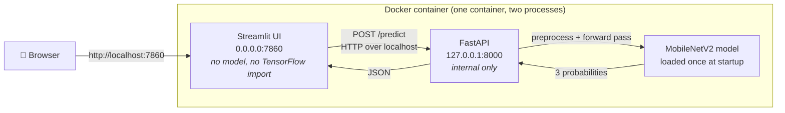
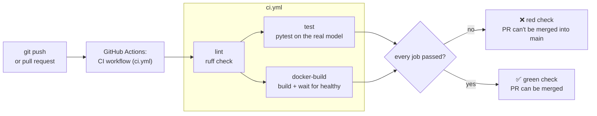

# 🌽 Corn Leaf Disease Classifier: production stack

A MobileNetV2 classifier for corn leaf diseases, built as a real service: a **FastAPI** inference API, a **Streamlit** frontend that calls it over HTTP, packaged with **Docker**, and tested on every push by **GitHub Actions**.


---

## Why a classifier and not the RAG chatbot

This project is about the **pipeline** (tests, CI, containers), so I picked the model that makes a pipeline meaningful.

- **Deterministic outputs can be tested.** The same image always produces the same probabilities, so CI can assert `predicted_class == "Corn_(maize)___Common_rust_"` on a known rust leaf. That's a real pass/fail gate. A regression in preprocessing, a wrong `class_names.json` or a broken model file turns CI red.
- **LLM outputs can't be tested the same way.** A RAG answer is worded differently each run, and "is this answer correct?" has no `assert`. You end up with string-contains checks that pass on wrong answers, or an LLM grading an LLM: slow, costly and itself non-deterministic.
- **No API quota means CI isn't flaky.** The model ships inside the repo, so tests need no network, no API key and no rate limit. A red build always means the code is broken, never "the provider was slow today". Flaky CI trains people to ignore red builds, which defeats the point.

A RAG app is a fine product. It's the wrong choice for demonstrating a CI pipeline whose job is to block bad code.

---

## Architecture

### Runtime: what happens when you upload a photo



The UI never touches the model. It's just an HTTP client of the API, like `curl` or a mobile app would be. That's why the model could be moved to its own server by changing one environment variable (`API_URL`).

### CI: what happens when you `git push`



Branch protection on `main` makes `lint`, `test` and `docker-build` required checks, so code that fails any of them can't reach `main`.

---

## Tech stack

| Component | Version | Why this choice |
|---|---|---|
| Python | 3.13 | The version the model was trained with. numpy 2.5.4 needs ≥ 3.12. |
| TensorFlow (CPU) | `tensorflow-cpu` 2.21.0 | Typical container hosts have no GPU. The GPU build adds several GB of CUDA libraries that would never run. |
| Keras | 3.15.1 | Pinned to the version that saved the `.keras` file, so it loads identically. |
| Model | MobileNetV2 (transfer learning), 2.26 M params, 9.6 MB | Small and fast on CPU. Preprocessing is built into the model as a layer, so the server can't forget it. |
| FastAPI | 0.162.4 | Request validation, typed responses and auto-generated `/docs`, all from type hints. |
| Uvicorn | 0.54.0 | The ASGI server that runs FastAPI. |
| Streamlit | 1.67.0 | A full UI in about 200 lines of Python, without writing JavaScript. |
| Docker base | `python:3.13-slim` | Debian/glibc, so TensorFlow and numpy install from prebuilt wheels. Alpine (musl) would compile them from source. |
| CI | GitHub Actions | Free for public repos and lives next to the code. |
| Lint / tests | ruff 0.17.4, pytest 9.2.0 | ruff lints the whole repo in milliseconds; pytest with FastAPI's `TestClient` needs no running server. |
| Large files | Git LFS | Keeps the model and test images out of normal git history; CI checks them out with `lfs: true`. |

---

## The single-container decision

Many container hosts (Hugging Face Spaces, Google Cloud Run, Render's free tier) expose **exactly one port per app**. A two-service setup (API container + UI container) can't be reached from outside there. So the main image runs both processes in one container:

1. `start.sh` starts **uvicorn** in the background on `127.0.0.1:8000`. That's localhost only, because only the UI needs it.
2. It **polls `/health`** until the API answers (no blind `sleep 10`: model load time varies by machine).
3. It `exec`s **Streamlit** in the foreground on `0.0.0.0:7860`. If Streamlit dies, the container exits and gets restarted instead of hanging half-alive.

The image also runs as a non-root user with UID 1000, which several hosts require.

For local development, **[`docker-compose.yml`](docker-compose.yml) runs the same image as two separate services**, `api` and `ui`, on a shared network. The UI finds the API by service name (`API_URL=http://api:8000`). That's how you'd deploy on a platform where each service scales independently. Both setups use one image and one codebase; only the start command differs.

---

## API reference

Interactive docs: `/docs` (Swagger UI, generated by FastAPI). In the single container the API is internal, so use the compose setup or run uvicorn locally to reach it.

| Method | Path | Purpose | Status codes |
|---|---|---|---|
| GET | `/` | Service metadata and endpoint list | 200 |
| GET | `/health` | Liveness + readiness | **200** model loaded · **503** model not loaded |
| GET | `/model-info` | Model version, classes (in output order), test metrics | 200 · 503 |
| POST | `/predict` | Classify an uploaded image (multipart field `file`) | 200 · **400** not an image · **413** over 10 MB · **422** no file · **503** model not loaded |
| GET | `/docs` | Swagger UI | 200 |

**Why 503 and not 500 when the model isn't loaded:** the request was fine and the server just isn't ready. Load balancers and orchestrators treat 503 as "retry or route elsewhere". If the model fails to load, the app still starts and `/health` reports why. You get a clear signal instead of a container stuck in a restart loop.

**Why `/predict` is a plain `def` and the others are `async def`:** inference is blocking CPU work. FastAPI runs plain `def` endpoints in a thread pool, so the event loop stays free for `/health` and other requests. As `async def`, the forward pass would run *on* the event loop and freeze every other request until it finished.

### Examples (real output)

```
curl http://127.0.0.1:8000/health
{"status":"healthy","model_loaded":true,"error":null}
```

```
curl -F "file=@tests/fixtures/rust.jpg" http://127.0.0.1:8000/predict
{"predicted_class":"Corn_(maize)___Common_rust_",
 "confidence":0.9997513890266418,
 "probabilities":{"Corn_(maize)___Common_rust_":0.9997513890266418,
                  "Corn_(maize)___Northern_Leaf_Blight":0.000248643453232944,
                  "Corn_(maize)___healthy":2.7457405238351384e-8},
 "inference_ms":300.8}
```

```
curl http://127.0.0.1:8000/model-info
{"model_file":"corn_disease_model.keras","model_version":"2026-11-09-e201e4efe7ec",
 "sha256":"e201e4ef...","classes":["Corn_(maize)___Common_rust_",
 "Corn_(maize)___Northern_Leaf_Blight","Corn_(maize)___healthy"],
 "input_size":[224,224,3],"training_date":"2026-11-09T19:21:39",
 "test_accuracy":0.9714,"per_class":{...},"n_test":490}
```

```
curl -F "file=@pytest.ini" http://127.0.0.1:8000/predict           -> 400
{"detail":"File is not a valid image (JPEG or PNG expected)"}

curl -X POST http://127.0.0.1:8000/predict                         -> 422
{"detail":[{"type":"missing","loc":["body","file"],"msg":"Field required","input":null}]}
```

`probabilities` is sorted highest first and always contains all three classes. `model_version` is the training date plus the first 12 characters of the model file's SHA-256, so you can tell exactly which weights are being served.

---

## Local development (Windows CMD)

Install [Git LFS](https://git-lfs.com) and run `git lfs install` **before cloning**, or `models/` will contain small pointer files instead of the model.

```bat
git clone https://github.com/HansTeee/corn-disease-ml-app.git
cd corn-disease-ml-app
```

**Without Docker** (fastest edit-run loop):

```bat
python -m venv .venv
.venv\Scripts\activate
pip install -r requirements-dev.txt

ruff check .
pytest -v

:: Terminal 1: the API
uvicorn api.main:app --port 8000

:: Terminal 2: the UI (talks to http://127.0.0.1:8000 by default)
streamlit run ui/app.py
```

**Docker Compose: two services, as on a scalable platform:**

```bat
docker compose up --build
:: UI:       http://localhost:8501
:: API docs: http://localhost:8000/docs
docker compose down
```

**Single container: the deployable image:**

```bat
docker build -t ml-app .
docker run -p 7860:7860 ml-app
:: UI: http://localhost:7860   (the API is internal to the container)
```

---

## CI

**[`ci.yml`](.github/workflows/ci.yml)** runs on every pull request and every push to `main`:

| Job | What it does | Why |
|---|---|---|
| `lint` | `ruff check .` (installs only ruff) | Catches unused imports, undefined names and common bugs in seconds, before any slow job runs. |
| `test` | `pytest` with the real model and three held-out test images | Asserts each image gets the **correct** class, probabilities sum to 1, bad uploads get 400/413/422, and a missing model gives 503 instead of a crash. |
| `docker-build` | Builds the image, starts it, waits for `HEALTHCHECK` to say healthy | "It builds" isn't "it starts". This catches a missing model file, a broken `start.sh` or an import error. Builds only, never pushes. |

`test` and `docker-build` run in parallel after `lint`. pip downloads are cached (`actions/setup-python` with `cache: pip`) and Docker layers are cached in GitHub's cache, so a code-only change doesn't re-download TensorFlow.

**Branch protection:** `main` requires a pull request, and the `lint`, `test` and `docker-build` checks must pass before it can be merged.

### Proof that a failing test blocks a merge

[PR #1](https://github.com/HansTeee/corn-disease-ml-app/pull/1) deliberately broke one test: it changed the expected class for `rust.jpg` (a held-out Common rust image) to `healthy`. The model still answered correctly, so the test failed. The output below is from that PR's CI run:

```
FAILED tests/test_api.py::test_model_info_has_expected_keys - AssertionError: assert ['Corn_(maize...e)___healthy'] == ['Corn_(maize...e)___healthy']
FAILED tests/test_api.py::test_predict_returns_correct_top_class[rust.jpg-Corn_(maize)___healthy] - AssertionError: assert 'Corn_(maize)___Common_rust_' == 'Corn_(maize)___healthy'
FAILED tests/test_api.py::test_predict_handles_rgba_png - AssertionError: assert 'Corn_(maize)___Common_rust_' == 'Corn_(maize)___healthy'
```

3 failed, 11 passed. The `test` check went red, and GitHub reported the PR's merge state as `BLOCKED`. The PR was closed without merging. Open the PR to see the failed checks.

---

## Performance

| Metric | Value | Where measured |
|---|---|---|
| Docker image size | **2.7 GB** (TensorFlow CPU alone is 1.29 GB unpacked; no CUDA libraries) | `docker images` |
| Cold build, no cache | 6 min 20 s | local, 24-core Windows + Docker Desktop |
| Rebuild after a code-only change | 24 s | local (the dependency layer is cached) |
| Container start → healthy | 12–18 s (model load 3.2 s of that) | local |
| Warm prediction (server-side) | ~190–300 ms | local container logs |
| Test suite | 7–14 s for 14 tests (~8 s is loading TensorFlow + the model once) | local |
| CI run time (warm cache) | ~1 min 40 s total: lint 11 s, then test 52 s and docker-build 1 min 21 s in parallel | GitHub Actions ([PR #2 run](https://github.com/HansTeee/corn-disease-ml-app/actions/runs/43012549661)) |
| CI run time (empty cache) | ~5 min 50 s (docker-build 5 min 31 s re-downloads everything) | GitHub Actions, first run |

---

## Limitations

- **Lab photos, not field photos.** The model was trained on PlantVillage: single detached leaves on a plain board under even light. It scores **97.1%** on the held-out PlantVillage test set, but only **50% (5/10)** on real-world corn photos from Wikimedia Commons (44% on all 25 eligible photos; random guessing is 33%). It found just 2 of 15 real-world Common rust photos, usually calling them Northern Leaf Blight at over 90% confidence.
- **No "unknown" class.** Every image gets one of the three labels, with probabilities summing to 100%. A portrait of a person scored Northern Leaf Blight 52.2% (the UI's low-confidence warning fired). The matplotlib logo scored **Northern Leaf Blight 96.3%** (no warning). Low confidence is a useful hint, but high confidence doesn't mean the image is a corn leaf.
- **The API can't scale independently of the UI.** In the single container, more prediction capacity means more copies of the whole app. `docker-compose.yml` shows the split version.
- **Not hosted publicly.** CI proves every commit builds, passes the tests and starts healthy, but nothing deploys it automatically. Running it means `docker run` locally or on a container host.
- **No authentication and no rate limiting.** Anyone who can reach the app can call the API as often as they like. Uploads are capped at 10 MB and 25 megapixels, but that's the only protection.
- **No monitoring or drift detection.** Predictions are logged, but nothing tracks confidence or class distribution over time, so a shift in what people upload would go unnoticed.

---

## Project layout

```
api/            FastAPI app: main.py (HTTP), inference.py (model), schemas.py (response models)
ui/app.py       Streamlit frontend; calls the API over HTTP, never imports the model
models/         corn_disease_model.keras, class_names.json, metrics.json  (Git LFS)
tests/          test_api.py + fixtures/ (one held-out test image per class)
Dockerfile      multi-stage, single container (both processes, port 7860)
start.sh        starts the API, waits for /health, then Streamlit
docker-compose.yml   local two-service setup
.github/workflows/   ci.yml
```

Model training, the leakage-safe data split and the shortcut analysis live in the separate training project (`plant-disease-classifier`).
